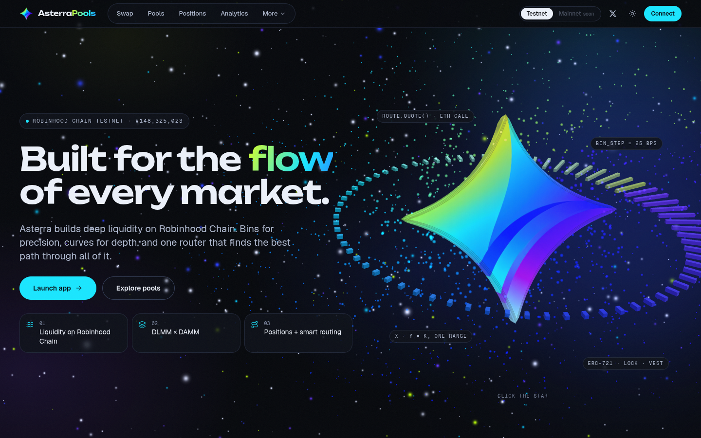

<p align="center">
  
</p>

<h1 align="center">AsterraPools</h1>

<p align="center"><b>Built for the flow of every market.</b></p>

<p align="center">
  Liquidity on Robinhood Chain: DLMM bins for precision, DAMM ranges for depth,<br />
  LP positions you can hold and one smart router across every venue.
</p>

<p align="center">
  <a href="https://asterrapools.tech">asterrapools.tech</a> ·
  <a href="https://testnet.asterrapools.tech">Testnet app</a> ·
  <a href="https://x.com/pulseofaster?s=21">@PulseOfAster</a>
</p>

<p align="center">
  
</p>

## What it does

- **Smart routing.** One router quotes every venue with on-chain `eth_call` simulations, compares direct and two-hop
  paths and settles the best one atomically. Native ETH is wrapped and unwrapped for you.
- **DLMM.** Discrete-bin pools: each bin is a constant-sum market at `(1 + binStep)^id`, so trades inside a bin have
  zero slippage. Spot, Curve and Bid-Ask shapes, plus single-bin limit orders.
- **DAMM.** Single-range concentrated pools with fungible shares, a volatility fee and an optional launch fee that
  starts high and decays to the base fee.
- **Uniswap v4 hook pools.** One Asterra hook on the canonical PoolManager: volatility-adaptive fees, and an oracle
  guard with a circuit breaker for tokenized stocks.
- **LP positions.** v4 positions are ERC-721 NFTs with permanent or timed locks and cliff + linear vesting.
- **Data.** Pool discovery (trending, most traded, highest volume, fresh), analytics, a live event feed, a typed SDK
  and a read-only REST API.

## Architecture

```
apps/web             Next.js app (TypeScript, Tailwind, wagmi, viem, RainbowKit, three.js)
packages/contracts   Foundry: hub, hook, router, positions, DLMM, DAMM, launchpad, credit, buyback
packages/sdk         ABIs, per-network addresses, chains, route finder, price and bin math
supabase             Postgres migrations, `api` and `indexer` edge functions, seed
infra                Docker Compose stack for the VPS: Postgres, PostgREST, edge-runtime, Caddy
scripts              local chain, deploy, verification and VPS helpers
docs                 progress, releases, infrastructure, style guide
```

1. Contracts emit events on Robinhood Chain.
2. pg_cron calls the `indexer` function every minute; it writes pools, swaps and positions into Postgres.
3. The `api` function serves read-only JSON at `/api/*`.
4. The web app reads live state with wagmi and history from the API.

## Contracts

Core contracts are UUPS (ERC-1967) proxies with ERC-7201 namespaced storage; repeated pool contracts are beacon
proxies, so one upgrade reaches every pool. Apps always use the proxy address.

| Contract | Role |
|---|---|
| `AsterraHub` | Registry and protocol config: venues, assets, oracles, fee config |
| `AsterraHook` | Uniswap v4 hook: dynamic fee, oracle guard, circuit breaker, protocol fee |
| `AsterraRouter` | Exact-input swaps across v4, DLMM, DAMM and launch curves |
| `AsterraPositions` | ERC-721 v4 LP positions with locks and vesting |
| `AsterraDLMMFactory`, `AsterraDLMMPool`, `AsterraDLMMLimitOrders` | Bin liquidity and single-bin limit orders |
| `AsterraDAMMFactory`, `AsterraDAMMPool` | Single-range pools with launch fee schedules |
| `AsterraLaunchpad`, `AsterraLaunchToken` | Bonding-curve launches graduating into v4 liquidity |
| `AsterraLendingVault`, `AsterraCreditManager` | Borrow against LP positions |
| `AsterraBuyback`, `AsterraToken` (ASTER) | Protocol revenue into ASTER, then burned |

Addresses per network: [`packages/sdk/src/addresses`](packages/sdk/src/addresses), and the app's `/contracts` page.
Build: Solidity 0.8.26, EVM `cancun`, `via_ir`, optimizer 800 runs. The hook is deployed through CREATE2 to an
address mined for its permission flags.

## Releases

| Release | Contents |
|---|---|
| Testnet | everything deployed; V1.0 open |
| **V1.0** | smart router, v4 hook, DLMM + limit orders, DAMM, LP positions |
| **V2.0** | stock pools with the oracle guard, launchpad |
| **V3.0** | ASTER, buyback & burn, credit |

Details and the gas budget: [`docs/RELEASES.md`](docs/RELEASES.md).

## Quick start

Requirements: Node 24, pnpm 11, [Foundry](https://book.getfoundry.sh/), Docker.

```bash
# Run in: repo root
pnpm install
bash scripts/local-chain.sh      # Anvil fork of testnet (chain 31337)
bash scripts/local-deploy.sh     # deploy every module by impersonating the deployer
pnpm dev                         # http://localhost:3000
```

Checks:

```bash
# Run in: repo root
pnpm lint && pnpm typecheck && pnpm test
(cd packages/contracts && forge test)
(cd apps/web && pnpm build && pnpm test:e2e)
```

## Deploy

```bash
# Run in: repo root
bash scripts/testnet-deploy.sh --broadcast           # contracts (asks for the keystore password once)
bash scripts/vps-deploy.sh testnet   # VPS stack, HTTPS, migrations, addresses
pnpm testnet:verify                  # verify every contract on the explorer (interactive, made for screen recording)
```

CI (`.github/workflows/build.yml`) only builds: checks on every push, and the web image for the `testnet` and
`mainnet` branches. See [`docs/infrastructure.md`](docs/infrastructure.md).

## Branches

`main` is development. `testnet` and `mainnet` carry what runs on each network and are updated by pull request from
`main`. Commits follow [Conventional Commits](https://www.conventionalcommits.org/).

## License

[MIT](LICENSE)
